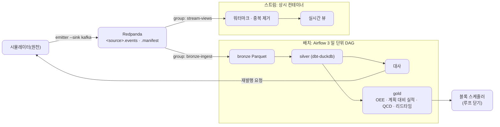
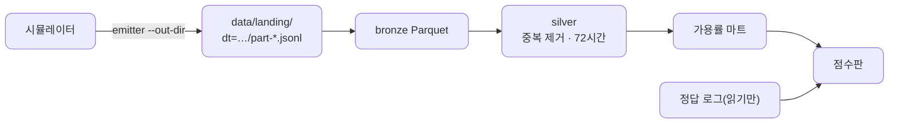

# 가상 조선소 데이터 플랫폼 개발 계획

2026-11-10 기준 · 원천: [virtual-shipyard-simulator](https://github.com/loozy5331/virtual-shipyard-simulator) `v0.5.0`([원천 계획](https://github.com/loozy5331/virtual-shipyard-simulator/blob/develop/docs/development-plan.md))

시뮬레이터가 내는 노이즈 섞인 이벤트를 받아, 정답과 똑같이 복원한 기록과 OEE·리드타임 마트를 만든다. 파일로 받는 작은 배치에서 시작하고, 겪은 문제가 다음 구성 요소를 부를 때마다 Phase를 하나씩 더한다. 11/29 배치 공개, 12/13 스트림 공개, 12/20 완료.

**진행 상황**: Phase 0 완료. 11/10에 입구를 Kafka에서 파일로 되돌리고 레포를 비웠다([ADR-002](adr/002-file-landing-zone.md)). 다음은 Phase 1의 `feat/bronze`.

## 목표: 최종 형태

배치가 정답과 같은 기록을, 스트림이 지금 상태를 맡는다. 레포는 처음부터 이 모습을 담지 않는다.

## 원칙

- **정답으로 채점한다**: 점수판이 원천의 정답 로그와 결과를 맞춘다. 완료 기준은 점수판의 칸이다.
- **같은 입력이면 같은 결과**: 같은 `dt`는 같은 bronze로, 같은 `event_id`는 한 줄로. 재실행·백필이 결과를 바꾸지 않는다.
- **필요할 때 들인다**: 구성 요소는 앞 Phase에서 겪은 문제가 부를 때, 파일은 처음 쓰는 할 일과 함께 들어온다. 빈 자리 파일을 미리 두지 않는다. 할 일의 설계·작업 계획 문서는 끝나면 지우고, 결정은 ADR과 이 문서에 남긴다. Spark는 쓰지 않는다(ADR-001).
- **경계를 지킨다**: 착륙 구역부터 플랫폼이다. 원천에는 재발행 요청 파일로만 말한다.
- **세 가지를 남긴다**: Phase마다 먼저 실패하는 테스트, ADR, 회고 한 줄.
- **누가 짜나**: 핵심 로직과 장애 훈련은 직접 `(직접)`, 밑작업·배선·문서·리뷰는 Claude `(Claude)`.

## Phase 지도

| Phase | 기간 | 핵심 | 끝날 때 보이는 문제 → 다음 |
| --- | --- | --- | --- |
| 0. 레포 | 10/27, 11/10 | 레포 뼈대, CI, ADR-001·002 | |
| **1. MVP 배치** | 11/11–11/18 | 파일 입구 → bronze → silver → 가용률 마트, 점수판, Airflow DAG·백필·경보 | **누락 때문에 가용률이 정답과 다르다** |
| 2. 대사 | 11/19–11/23 | `seq` 빈 번호 + 마감 집계, 재발행 요청, `part-replay-*` 받기, 대사 ADR. 볼 것: 통째로 빠진 개체, 재발행된 `dt` 다시 돌리기 | 가용률 = 정답. **지금 설비가 섰는지는 다음 날에야 안다** |
| 3. 마트·**배치 공개 11/29** | 11/24–11/29 | 계약 검증·격리 표·깨진 줄 훈련, OEE(성능 = 계획 소요 ÷ 실제 소요, 품질 1)·계획 대비 실적·QCD(D = 납기 대비 인도일, C = 공수 MH), `v0.1.0` | |
| 4. Kafka·스트림 | 11/30–12/8 | Redpanda 되살리기(PR #2), 강제 종료 훈련 먼저 → 수동 커밋·오프셋 이름 파일 → 리밸런스·브로커 재시작, 스트림 소비자(워터마크 10분, 파티션별 최솟값), 실시간 뷰, Kafka 입구·스트림 ADR. 볼 것: bronze 묶음 크기, 원자적 쓰기 | **스트림 값과 배치 값이 다르다** |
| 5. 비교·**스트림 공개 12/13** | 12/9–12/13 | 닫힌 날 스트림 대 gold, 차이를 늦음·누락·재발행으로 설명, 워터마크 다시 정하기, `v0.2.0` | |
| 6. 루프 닫기·**완료 12/20** | 12/14–12/20 | MH/t 보정 → 블록 스케줄러 "지연 N% 감소", 리드타임 마트, 성능 측정 한 번, 블로그, `v1.0.0` | |

**밀리면 줄이는 순서**: Phase 3 마트를 OEE 하나로 → 리드타임 마트를 12/20 뒤로. 대사, 배치 공개, 입구 옮기기 훈련, 루프 닫기는 줄이지 않는다. 12/20 뒤 선택: 4M 스윕, 규모 실험, 스트림 뷰 더.

## Phase 1 · MVP 배치

할 일 하나 ≈ 하루. 괄호는 브랜치, "들임"은 그 할 일과 함께 레포에 들어오는 것이다.

- [ ] `dt` 하나의 `part-*.jsonl` 전부 → `data/bronze/dt=…/` Parquet, 다시 돌리면 덮어씀, 원본 줄·파일·줄 번호를 열로. 들임: `pipelines/ingest/`, pytest, gitignore의 `data/`·`.pytest_cache/` (feat/bronze) (직접. 시그니처·첫 테스트·데이터 준비는 Claude)
- [ ] `stg_events`(`event_id`마다 가장 이른 도착), 72시간 되돌아보기, 품질 테스트, silver·늦음 ADR. 들임: `dbt/`, `contracts/`와 CI 대조, 계약 사본 ADR, silver 열 ↔ 계약 테스트 (feat/silver) (직접)
- [ ] 가용률 마트: 설비 down→up, 작업장 묶음별. 같은 매크로를 정답 로그에도 (feat/mart-availability) (직접)
- [ ] 점수판: 가용률 오차 + 중복·늦음·누락 수, 회고 한 줄. 들임: `pipelines/scoreboard/` (feat/scoreboard) (계산은 직접)
- [ ] 일 단위 DAG, Asset, pool 1·`max_active_runs=1`. 들임: `docker-compose.yml`(Postgres·Airflow 3), `airflow/dags/` (feat/dag) (직접)
- [ ] 신선도·행 수 경보, **훈련**: 방출을 멈춰 경보 확인 (feat/observability) (직접)
- [ ] `airflow backfill create`, 백필 두 번 = 같은 결과, 운영·백필 ADR (feat/backfill) (직접)

`feat/scoreboard`까지는 호스트에서 `uv run`으로 돌린다. 손으로 돌리고 재실행·백필을 관리하기 번거로워지는 것이 `feat/dag`의 까닭이다.

**점수판**(원천 5년, 시드 0)

| 칸 | Phase 1에서 | 목표 |
| --- | --- | --- |
| 가용률 오차 | 누락만큼 어긋남 | 가공 97.0 · 조립장 97.6 · 도크 98.0 · 선석 98.2%와 같음(Phase 2) |
| 유일성 | 0(중복 559개 제거) | 0 |
| 늦음 반영 | 72시간 안의 늦음 모두 반영 | 모두 반영 |
| 완전성 | 누락 266개를 센다 | 0(Phase 2) |
| 신선도 | 경보 기준 안 | 경보 기준 안 |

**열린 질문**
- DAG run 하나가 `dt` 하나인가, 닫힌 `dt` 전부인가? 5년치(약 1,826일)를 run 하나씩 돌리면 백필이 몇 시간 걸린다. 운영·백필 ADR에서.
- `dt` 닫힘을 무엇으로 아나? 시작안: 다음 `dt` 폴더가 보이면 닫힘. 재발행 파일이 처리 날짜 `dt`에 생겨 오판할 수 있다. 운영·백필 ADR에서.
- 72시간보다 늦게 오는 이벤트가 있나? silver 전에 `emitted_at` − `occurred_at` 최댓값을 잰다.
- `warehouse.duckdb` 잠금: DAG가 쓰는 동안 다른 프로세스가 못 연다. gold·점수판을 Parquet으로 내보낼지.
- 정답 로그를 Airflow 태스크에서 어떻게 읽나(마운트 또는 복사). `feat/dag`에서.

## 결정 기록

- [ADR-001 스택](adr/001-stack.md): DuckDB·Parquet·dbt-duckdb, Airflow 3(2와의 차이)
- [ADR-002 MVP 입구는 파일 착륙 구역](adr/002-file-landing-zone.md)
- 다음(번호는 쓸 때 다음 번호를 받는다): 계약 사본(`feat/silver`. 태그 고정, 손으로 고치지 않음, 레지스트리 안 씀. 이전 글은 PR #23), silver·늦음(Phase 1), 운영·백필(Phase 1), 대사(Phase 2), Kafka 입구(Phase 4), 스트림(Phase 4)

## 참고

- 원천은 `v0.5.0`까지 나와 기다릴 것이 없다(파일·Kafka 출력, 재발행 서비스, 재생 속도). 블록 스케줄러 입력 양식은 Phase 6에서 확인한다.
- 시뮬레이터 레포: ADR-005 노이즈, ADR-006 마감 집계·재발행, ADR-007 경계, ADR-010 설비 고장, ADR-011 자재, ADR-013 재생 속도
- [시뮬레이터 도메인 모델 (초안)](https://claude.ai/artifact/T4ebwv74rLvAjNBJfzn43p)
