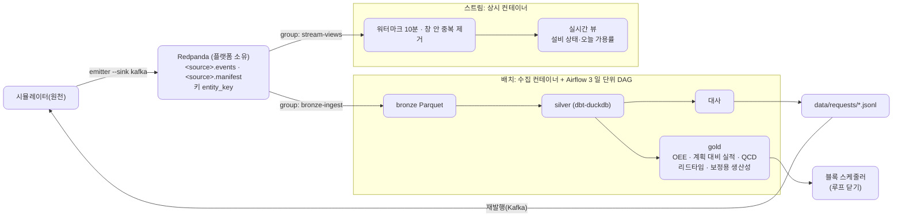
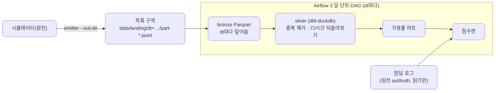

# 가상 조선소 데이터 플랫폼 개발 계획

2026-11-10 기준(10/27 수립, 11/10 Phase로 다시 짬) · 원천: [virtual-shipyard-simulator](https://github.com/loozy5331/virtual-shipyard-simulator) `v0.5.0`(계약은 `v0.3.0`에 고정)([원천 계획](https://github.com/loozy5331/virtual-shipyard-simulator/blob/develop/docs/development-plan.md))

가상 조선소 시뮬레이터가 내는 노이즈 섞인 이벤트를 받아, 정답과 똑같이 복원한 기록과 OEE·리드타임 마트를 만든다. 파일 착륙 구역으로 받는 작은 배치에서 시작하고, 겪은 문제가 다음 구성 요소를 부를 때마다 Phase를 하나씩 더한다. 11/29에 배치를 공개하고, 12/13에 스트림을 더하고, 12/20에 끝낸다.

**진행 상황**
- Phase 0 완료(10/27): 레포 뼈대, CI, 계약 사본, compose.
- 11/10 다시 짬: 0단계가 처음부터 최종 형태(Redpanda, 토픽 여섯)로 깔려 MVP가 없었고, Kafka를 들인 까닭을 겪은 문제로 설명할 수 없었다. 입구를 파일로 되돌리고 계획을 Phase 0~6으로 다시 짰다([설계](specs/2026-11-10-phased-replan-design.md), [ADR-003](adr/003-file-landing-zone.md)).
- 다음: Phase 1 MVP 배치(11/11–11/18).

이 문서의 Phase는 플랫폼의 개발 단계다. [구직 로드맵](https://claude.ai/artifact/ELB4AwJNmtya8ebpVREN2H)의 Phase 1~3과는 다르다.

## 목표: 최종 형태

끝났을 때의 모습이다. 레포가 처음부터 이 모습을 담지 않고, Phase마다 필요한 만큼만 자란다.

입구는 Kafka 하나다. 배치가 정답과 같은 기록을, 스트림이 지금 상태를 맡는다. 둘은 같은 토픽을 다른 소비자 그룹으로 받는다.

## 지금: Phase 1의 모습

- compose에는 Postgres와 Airflow 3(LocalExecutor)만 뜬다. 마운트는 `./data:/data` 하나다.
- 저장은 Parquet(bronze)과 `data/warehouse.duckdb`(silver·gold)다. `warehouse.duckdb`는 Airflow만 쓴다(pool 1, `max_active_runs=1`).
- 채점용으로 원천의 정답 로그(`out/truth`)를 읽기만 한다. 파이프라인은 쓰지 않고 점수판만 읽는다.

## 원칙

- **정답으로 채점한다**: 점수판이 원천의 정답 로그와 결과를 맞춘다. Phase의 완료 기준은 점수판의 칸이다.
- **같은 입력이면 같은 결과**: 같은 `dt`는 같은 bronze로, 같은 `event_id`는 한 줄로. 재실행과 백필이 결과를 바꾸지 않는다.
- **Phase마다 끝까지 돈다**: `docker compose up -d`와 명령 하나로 입구부터 그 Phase의 표와 점수판까지 나온다.
- **필요할 때 들인다**: 구성 요소(대사, Kafka, 스트림 소비자)는 앞 Phase에서 겪은 문제가 부를 때 들인다. 들이는 까닭은 ADR의 맥락에 겪은 문제로 적는다. 처리는 노트북 한 대에서 도는 DuckDB·Parquet·dbt로 하고 Spark는 쓰지 않는다(ADR-001).
- **경계를 지킨다**: 착륙 구역부터 플랫폼이고, 대사도 플랫폼의 것이다(원천 ADR-007·008). 원천에는 재발행 요청 파일로만 말한다.
- **스트림과 배치를 섞지 않는다**(Phase 4부터): 소비자 그룹·저장소·실행 주체를 따로 둔다. 정답과 같아야 하는 것은 배치가, 지금 상태는 스트림이 맡는다.
- **Phase의 끝에는 세 가지를 남긴다**: 먼저 실패하는 테스트, 결정을 담은 ADR, 회고 한 줄(무엇이 틀렸고 어떻게 알았나). 세 가지가 그대로 면접 원고가 된다.
- **누가 짜나**: 계획의 "배우는 것"에 해당하는 핵심 로직(bronze 쓰기, 중복 제거·되돌아보기, 지표 SQL, 점수판 계산, 대사, 소비자 커밋, 워터마크)은 직접 짜고, 장애 훈련도 직접 돌린다. Claude는 밑작업(설정, 배선, 출력 형식, fixture, 문서)과 리뷰를 맡는다. 할 일마다 `(직접)`·`(Claude)`로 적는다.
- **시간**: 서울(11/9부터) 오전 4시간. 할 일 하나 ≈ 하루, PR 1~2개. 끝나면 README "만든 것"에 한 줄.

## Phase 지도

| Phase | 기간 | 만드는 것 | 배우는 것 | 끝날 때 보이는 문제 → 다음 Phase |
| --- | --- | --- | --- | --- |
| 0. 레포와 로컬 인프라 | 10/27, 11/10 정리 | 레포 뼈대, CI, 계약 사본, compose(10/27에는 Redpanda도, 11/10부터 Postgres·Airflow 3만), ADR-001~003 | 컨테이너 네트워크·볼륨, 계약 고정 | |
| 1. MVP 배치 | 11/11–11/18 | 착륙 구역 → bronze → silver(중복 제거, 72시간 되돌아보기) → 가용률 마트, 점수판, 일 단위 DAG, 재실행·백필, 실패·신선도 경보 | 끝까지 관통하는 최소 경로, 멱등 키, 이벤트 시각 처리, 운영 | 중복·늦음은 풀렸지만 **누락 때문에 가용률이 정답과 다르다** |
| 2. 대사 | 11/19–11/23 | `seq` 빈 번호와 마감 집계로 누락 찾기, 재발행 요청 파일, 재발행분 받기 | 대사, 원천과 계약으로만 일하기 | 가용률 = 정답. 그런데 **지금 설비가 섰는지는 다음 날에야 안다** |
| 3. 마트 넓히기와 배치 공개 | 11/24–11/29 | OEE, 계획 대비 실적, QCD, 지표 정의 문서, README·`v0.1.0` | 지표 정의를 문서로 합의하기 | (가치를 쌓는 Phase) |
| 4. 실시간: Kafka와 스트림 | 11/30–12/8 | Redpanda와 토픽, 스트림 소비자와 실시간 뷰, 배치 입구를 Kafka로 옮기기(수동 커밋, 오프셋 이름 파일) | at-least-once, 오프셋, 리밸런스, 상태 있는 스트림 처리, 워터마크 | **스트림 값과 배치 값이 다르다** |
| 5. 스트림·배치 비교 | 12/9–12/13 | 닫힌 날의 스트림 대 gold 비교 DAG, 워터마크 다시 정하기, README 스트림 절·`v0.2.0` | 근사와 정확의 차이를 숫자로 설명하기 | |
| 6. 루프 닫기와 마무리 | 12/14–12/20 | 보정한 MH/t 생산성 → 블록 스케줄러, 리드타임 마트, 성능 측정 한 번, 회고, `v1.0.0` | 데이터가 결정을 바꾸는지 보이기, 배운 것을 설명하기 | |

| 게이트 | 날짜 | 확인할 것 |
| --- | --- | --- |
| 배치 공개 | 11/29 | `docker compose up -d`와 방출로 착륙 구역 → gold, 점수판 모든 칸이 목표 안, 운영 훈련 기록 |
| 스트림 공개 | 12/13 | 스트림과 배치가 함께 돌고 두 결과의 차이가 설명된다 |
| 정량 결과·완료 | 12/20 | "보정 후 지연 N% 감소" 한 줄, 리드타임 마트, 아키텍처 다이어그램, 블로그 1편 |

**밀리면 줄이는 순서**: Phase 3 마트를 OEE 하나로 → 리드타임 마트를 12/20 뒤로 → 스트림 뷰는 이미 설비 상태 하나. Phase 2 대사, Phase 3 배치 공개, Phase 4 입구 옮기기 훈련, Phase 6 루프 닫기는 줄이지 않는다.

## Phase별 할 일 (항목 하나 ≈ 하루)

괄호 안은 브랜치 이름이고, **훈련**은 그 Phase의 장애 훈련이다.

### Phase 0 · 레포와 로컬 인프라
- [x] 레포 뼈대, uv(Python 3.12)·ruff·pytest CI, develop 자동 머지 (chore/bootstrap) (Claude)
- [x] compose(Redpanda·Console·토픽 여섯, Postgres·Airflow 3), 원천 `v0.3.0` 계약 사본과 CI 대조, ADR-001·002 (Claude)
- [x] 11/10 정리: Kafka 쪽 걷어내기, 폴더 이름(`data/`, `scripts/`, `docs/specs/`·`docs/plans/`), ADR-003, 이 계획 (Claude)
### Phase 1 · MVP 배치
- [ ] 착륙 구역의 `dt` 하나(`part-*.jsonl` 전부. 재발행분 `part-replay-*`도 같은 `dt`에 생긴다) → `data/bronze/dt=…/` Parquet, 같은 `dt`를 다시 돌리면 덮어씀, 줄의 원본·파일·줄 번호를 열로 남김 (feat/bronze) (직접. 시그니처·첫 테스트·5년치 데이터 준비는 Claude)
- [ ] dbt-duckdb `stg_events`(`event_id`마다 가장 이른 도착 하나), 72시간 되돌아보기, 품질 테스트(착수 < 완료), ADR-004 (feat/silver) (직접. dbt 프로젝트 설정은 Claude)
- [ ] 가용률 마트: 설비 down→up 구간, 작업장 묶음(가공·조립장·도크·선석)별. 같은 매크로를 정답 로그에도 돌림 (feat/mart-availability) (직접)
- [ ] 점수판: 가용률 오차와 그것을 설명하는 중복·늦음·누락 수, 회고 한 줄 (feat/scoreboard) (계산은 직접, 배선·출력은 Claude)
- [ ] 일 단위 DAG(bronze → dbt → 점수판), Asset으로 이어 걸기, DuckDB 단일 쓰기용 pool 1·`max_active_runs=1` (feat/dag) (직접. compose·Airflow 설정은 Claude)
- [ ] 신선도·행 수 감시와 실패·신선도 경보, **훈련**: 방출을 멈춰 경보가 울리는지 (feat/observability) (직접)
- [ ] `airflow backfill create` 구간 백필, 백필 두 번 = 같은 결과, ADR-005 (feat/backfill) (직접)
### Phase 2 · 대사
- [ ] 마감 집계 받기(착륙 구역의 manifest 줄), 개체별 `seq` 빈 번호와 `last_seq`로 끝 번호 누락, 마감 뒤 72시간 기다리기 (feat/reconcile) (직접)
- [ ] `replay_request.json` 형식의 요청을 `data/requests/`에 쓰기, 착륙 구역으로 돌아온 재발행 받기, 점수판 완전성 0, ADR-006 (feat/replay-request) (직접)
### Phase 3 · 마트 넓히기와 배치 공개
- [ ] 봉투 스키마 검증(`contracts/` 사본), 위반 줄은 격리 표(원본·사유·파일·줄 번호), **훈련**: 깨진 줄 주입 (feat/contract) (직접)
- [ ] `mart_oee`(설비 × 일), `mart_plan_vs_actual`, `mart_qcd`, 지표 정의를 dbt 문서에 (feat/marts) (직접)
- [ ] README 실행법·구조·점수판·훈련 기록, `v0.1.0` (docs/gate) (Claude)
### Phase 4 · 실시간: Kafka와 스트림
- [ ] Redpanda·Console·토픽을 이력(PR #2)에서 되살리기, 방출기 `--sink kafka`, 토픽·키·파티션·보존 기간 ADR-007 (chore/kafka) (Claude)
- [ ] 배치 입구를 Kafka로: 소비자 그룹 `bronze-ingest`, **훈련 먼저**: 자동 커밋 소비자를 쓰기 도중 강제 종료해 유실을 점수판에서 확인 (test/drill-consumer-kill) (직접)
- [ ] 파일을 쓴 뒤 수동 커밋, 파일 이름 = 토픽·파티션·시작 오프셋, 소비자 둘과 리밸런스, 브로커 재시작 훈련에서 유실 0 (feat/ingest-commit) (직접)
- [ ] `stream-views` 소비자: 이벤트 시각 워터마크(허용 지연 10분), 창 안 `event_id` 중복 제거, 워터마크 밖 늦음 세기, ADR-008 (feat/stream-consumer) (직접)
- [ ] 실시간 뷰(설비 상태·오늘 가용률), 1분마다 Parquet 스냅샷, **훈련**: 스트림 소비자 재시작 뒤 상태를 토픽에서 다시 만든다 (feat/stream-views) (직접)
### Phase 5 · 스트림·배치 비교
- [ ] 비교 DAG: 닫힌 날의 스트림 가용률·이벤트 수 대 gold, 차이를 워터마크 밖 늦음·누락·재발행으로 나눠 설명, 워터마크 값 다시 정하기 (feat/stream-batch-check) (직접)
- [ ] README 스트림 절, `v0.2.0` (docs/stream-gate) (Claude)
### Phase 6 · 루프 닫기와 마무리
- [ ] 스케줄러 입력 열과 생산성 설정, 화면 없이 계산을 돌릴 수 있는지 확인 (spike/scheduler) (Claude)
- [ ] 기준선: 기본 생산성으로 돌린 지연 블록 수·총 지연일 (feat/export-scheduler) (직접)
- [ ] 실적 MH/t로 보정한 입력으로 다시 측정, 결과 한 줄 (feat/calibrate) (직접)
- [ ] `mart_material_lead_time`: 입고가 발주보다 먼저 오거나 아직 없는 경우를 따로 표시, 약속일 대비 늦음 비율. 시간이 모자라면 12/20 뒤로 (feat/mart-lead-time) (직접)
- [ ] 성능 측정 한 번(5년치 전체 재계산 대 하루 증분), 아키텍처 다이어그램, 단계별 회고를 모은 블로그 1편, `v1.0.0` (docs/final) (직접·Claude)
### 12/20 뒤 · 선택
- [ ] 4M 스윕: params를 바꾼 `run_id` 여러 개를 받아 `mart_4m`으로 OEE·납기·리드타임 비교
- [ ] 규모 실험: 15년 × 시드 5개, 파티션 가지치기, 스트림 처리량
- [ ] 스트림 뷰 둘 더: 진행 중 블록 수(WIP), 도착 지연 분포

마트 정의는 이렇게 잡는다. OEE의 가용률은 eam의 down→up 구간, 성능은 계획 소요(`planned_end` − 착수) ÷ 실제 소요다. 품질은 불량 이벤트가 아직 없어 1로 둔다. QCD는 D = 계약 납기 대비 인도일, C = 호선별 공수(MH)이고, Q는 보류다.

## 점수판

숫자는 원천 5년 실행(시드 0, `--until 2031-11-02`)의 노이즈 실측이다. 칸은 Phase마다 는다.

| 칸 | 보는 것 | 들어오는 Phase | Phase 1에서 보일 것 | 목표 |
| --- | --- | --- | --- | --- |
| 가용률 오차 | 작업장 묶음별 플랫폼 − 정답(%p), 정답 쪽 값도 함께 | 1 | 누락만큼 어긋남 | 가공 97.0 · 조립장 97.6 · 도크 98.0 · 선석 98.2%와 같음(Phase 2) |
| 유일성 | 같은 `event_id`가 두 줄 이상 | 1 | 0(중복 559개를 silver가 제거) | 0 |
| 늦음 반영 | 늦게 온 이벤트가 제 날짜 집계에 들었나 | 1 | 72시간 안의 늦음은 모두 반영 | 모두 반영 |
| 완전성 | 정답 대비 빠진 이벤트 | 1(세기만), 2(고침) | 원천 누락 266개 | 0(Phase 2) |
| 신선도 | 마지막 적재 시각, 착륙 구역 대비 밀림 | 1 | 경보 기준 안 | 경보 기준 안 |
| 스트림 오차 | 닫힌 날의 스트림 대 gold | 5 | | 차이가 늦음·누락·재발행으로 모두 설명됨 |

## 이웃 레포

플랫폼은 원천 계약(시뮬레이터 `v0.3.0`의 봉투, `seq`, 마감 집계, 재발행 요청 형식)에만 기댄다. 원천 쪽 할 일은 [시뮬레이터 계획](https://github.com/loozy5331/virtual-shipyard-simulator/blob/develop/docs/development-plan.md)에 둔다.

| 플랫폼이 쓰는 것 | 레포 | 쓰는 Phase | 상태 |
| --- | --- | --- | --- |
| 이벤트 계약, 파일 출력(`--out-dir`), 정답 로그 | 시뮬레이터 | 1부터 | 완료(`v0.3.0`) |
| 재발행 요청 디렉터리와 재발행 서비스 | 시뮬레이터 | 2 | 완료(`v0.4.0`, 원천 ADR-012) |
| 재생 속도(`--speed`, `--follow`) | 시뮬레이터 | 1(신선도 훈련), 4 | 완료(`v0.5.0`, 원천 ADR-013) |
| Kafka 출력(`--sink kafka`), 재발행을 Kafka로 | 시뮬레이터 | 4 | 완료(`v0.3.0`, 재발행은 `v0.4.0`) |
| 블록 입력 양식과 지연 판정 | `shipbuilding-block-scheduler` | 6 | Phase 6 첫 할 일로 확인 |
| 용접 불량 이벤트(QCD의 Q) | 시뮬레이터 | 선택 | 시뮬레이터 9단계 |

원천은 `v0.5.0`까지 나와 플랫폼이 기다릴 것이 없다. 계약 스키마는 `v0.3.0`과 같아 `contracts/`는 그대로 둔다.

## 결정 기록과 열린 질문

| ADR | 정할 것 | Phase | 상태 |
| --- | --- | --- | --- |
| [001 스택](adr/001-stack.md) | docker compose, Airflow 3(LocalExecutor), DuckDB + Parquet + dbt-duckdb, Spark를 쓰지 않는 까닭, Airflow 2와의 차이 | 0 | 확정(브로커는 Phase 4로) |
| [002 원천 계약과 토픽](adr/002-source-contract-and-topics.md) | 토픽·키·파티션, 계약 사본 | 0 | 대체됨(ADR-003) |
| [003 MVP 입구는 파일 착륙 구역](adr/003-file-landing-zone.md) | 파일 입구, `dt` 재실행 멱등, Kafka는 실시간 요구가 생길 때 | 0 | 확정 |
| 004 계층과 늦게 도착한 데이터 | bronze는 도착 기준, silver는 이벤트 시각 기준, 72시간 되돌아보기 | 1 | |
| 005 운영과 백필 | DAG run 단위와 `dt`, `dt` 닫힘 신호, 감시 지표와 경보 기준, 백필은 bronze에서 silver·gold를 다시 만드는 일로 한정 | 1 | |
| 006 대사와 재발행 요청 | 대사 범위(마감 집계 30일), 기다리는 시간, 요청 파일 이름을 내용에서 정해 멱등, 안 돌아온 요청의 상태 | 2 | |
| 007 Kafka 입구와 전달 보장 | 토픽·키·파티션·보존 기간, 파일을 쓴 뒤 커밋, 오프셋 이름 파일, 임시 파일 뒤 rename, `on_revoke`, at-least-once + 중복 제거를 고른 까닭 | 4 | |
| 008 스트림과 배치 나누기 | 소비자 그룹·저장소·실행 주체 분리, 워터마크 10분(파티션마다 잡고 최솟값), 복구는 배치만 | 4 | |

열린 질문

Phase 1
- 일 단위 DAG는 무엇을 하루로 보나? `dt`는 가상 날짜라 재생 속도 없이 방출하면 5년치(약 1,826일)가 한꺼번에 생긴다. 가상 날짜마다 DAG run을 하나씩 두면 `max_active_runs=1`에 dbt 시작 비용이 겹쳐 백필 한 번이 몇 시간 걸린다. 시작안: DAG run 하나가 아직 처리하지 않은 닫힌 `dt`를 모두 처리하고, 백필은 `dt` 범위를 인자로 받는다. ADR-005에서 정한다.
- `dt`가 닫힌 것을 DAG가 어떻게 아나? 방출기는 날짜 순서로 쓰고 닫힌 날짜 파일은 다시 쓰지 않는다(원천 `sim/io/writer.py`의 `PartitionedWriter`). 시작안: 다음 `dt` 디렉터리가 보이면 앞 `dt`를 닫힌 것으로 본다. 다만 재발행 서비스는 처리 시각의 `dt`(자정 직전이면 다음 날)에 `part-replay-*`를 만들 수 있어, 이 규칙이 오판할 수 있다. ADR-005에서 같이 정한다.
- 점수판과 정답 쪽 가용률은 원천의 정답 로그(`../virtual-shipyard-simulator/out/truth`)를 읽는데, compose의 마운트는 `./data:/data` 하나라 Airflow 태스크 안에서는 보이지 않는다. 읽기 전용 마운트를 더할지(`TRUTH_DIR`), `data/truth/`로 복사할지 `feat/scoreboard` 전에 정한다.
- `warehouse.duckdb`를 DAG가 쓰는 동안 다른 프로세스는 읽기 전용으로도 열 수 없다(DuckDB 파일 잠금). gold와 점수판을 DAG 끝에서 Parquet으로 내보내고 바깥은 그것만 읽게 할지 정한다.
- 72시간보다 늦게 오는 이벤트가 있나? 있으면 72시간 되돌아보기로는 "늦음 모두 반영"을 지킬 수 없다. silver를 짜기 전에 정답 로그와 착륙 구역으로 `emitted_at` − `occurred_at`의 최댓값을 잰다.
- 호선 금액과 비용 이벤트가 없어 QCD의 C는 공수(MH)로만 본다(Phase 3). 금액이 필요하면 시뮬레이터 계획에 요청으로 올린다.

Phase 2
- `seq` 빈 번호와 `last_seq`로 누락 266개를 모두 찾을 수 있나? 개체의 이벤트가 하나도 오지 않으면 빈 번호도 끝 번호도 보이지 않는다. 마감 집계가 개체 목록이나 개체 수를 주는지 원천 ADR-006에서 확인한다.
- 재발행분은 착륙 구역의 `dt=<처리 날짜>/part-replay-<처리 시각>.jsonl`로 돌아온다(원천 ADR-006). 처리 날짜의 `dt`에 들어가므로, 이미 처리한 `dt`라도 재발행 파일이 생기면 그 `dt`를 다시 돌려야 한다. 그 신호를 무엇으로 줄지 ADR-006에서 정한다.

Phase 4
- bronze 파일 하나에 메시지를 몇 개 담을까? 파일은 한 파티션의 연속된 오프셋 구간이고, 도착 날짜가 바뀌면 나눈다. 닫는 기준은 N건 또는 T초 중 먼저 오는 쪽(시작안 10,000건·60초)이다. 작은 파일은 silver가 읽을 때 합친다. ADR-007에서 정한다.
- 스트림 워터마크 10분은 가정이다. 보통 지연은 p95 39초지만 늦음 3%는 수 시간이라, 워터마크 밖으로 약 3%가 빠질 것으로 본다. Phase 5에서 재보고 정한다.
- 소비 지연 경보와 스트림 뷰는 재생 속도(`--speed`)가 있어야 의미가 있다. 실시간 compose(원천 `docker-compose.live.yml`)를 플랫폼 쪽에 어떻게 붙일지 정한다.

## 참고

- [가상 조선소 시뮬레이터 단계별 개발 계획](https://claude.ai/artifact/LeD43VMpbkKVCpZ8Gcp4Ka): 원천 쪽 할 일
- [가상 조선소 시뮬레이터 도메인 모델 (초안)](https://claude.ai/artifact/T4ebwv74rLvAjNBJfzn43p): 이벤트 봉투와 노이즈가 남기는 흔적
- [구직 실행 로드맵 (2026.10 – 2027.01)](https://claude.ai/artifact/ELB4AwJNmtya8ebpVREN2H): 구직 쪽 Phase 1~3과 게이트
- 시뮬레이터 레포: README(실행법·게이트 수치), ADR-005 노이즈, ADR-006 마감 집계·재발행, ADR-007 경계, ADR-008 대사는 플랫폼에, ADR-010 설비 고장, ADR-011 자재, ADR-012 컨테이너와 요청 디렉터리, ADR-013 재생 속도, `schemas/envelope.json`, `schemas/replay_request.json`
